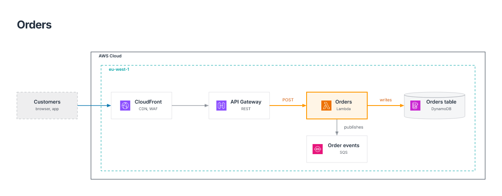
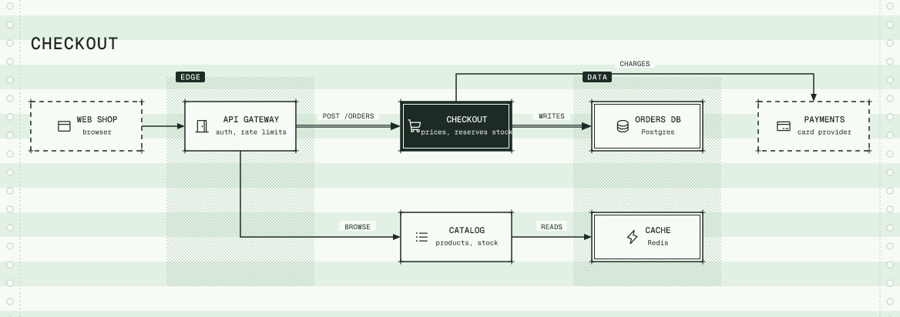
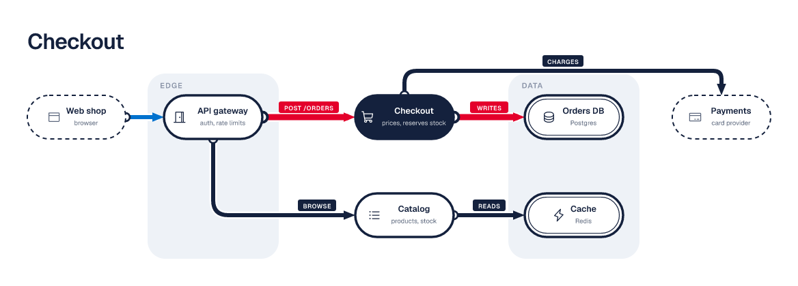

# FastDraw looks

Looks for [FastDraw](https://github.com/coccor/fastdraw) diagrams. A look sets the colours, fonts and drawing style of a diagram; these use the same style names as the built-in look (`node`, `focal`, `store`, `external` and the rest), so any diagram can switch to one without other changes.

- Three cloud looks: **Azure**, **AWS** and **Google Cloud**, each with the cloud's own icons and its groups (VPCs, subnets, resource groups).
- Six styles of drawing: **Engraved**, **Headline**, **Keys**, **Listing**, **Offset** and **Transit**. These used to ship inside FastDraw.

## Using a look

In the editor, open **Look**, type `coccor/fastdraw-looks` under **From GitHub**, and pick one. The editor writes the look line into the diagram.

In a `.fdraw` file, name the look by its address:

```
look "https://raw.githubusercontent.com/coccor/fastdraw-looks/main/engraved.look"
```

The `fastdraw` command line fetches the look from that address and keeps a copy in its cache folder, so the diagram renders offline after the first time (`--offline` uses only the cached copy). To keep a look next to your diagrams instead, download the `.look` file and write `look "./engraved.look"`.

## Cloud looks

The built-in look in each cloud's colours and type, on a white page, with the cloud's own service icons in place of FastDraw's outlines and extra styles for the cloud's groups. Boxes and text keep the built-in sizes, so a diagram drawn for the built-in look switches with one line; an icon it already uses from FastDraw's set still draws.

The icons and the font are fetched by address from jsDelivr, at fixed versions: the editor fetches the ones a diagram uses, and the command line keeps a copy for `--offline`. `fastdraw icons <look>` lists a look's icons, and `fastdraw icons <look> queue` searches them.

### Azure — `azure.look`

Azure blue, Open Sans and 146 Azure service icons by short name (`icon=app-service`, `functions`, `sql-database`, `cosmos-db`, `key-vault`, `front-door`, `service-bus`), from [Ben Coleman's icon collection](https://github.com/benc-uk/icon-collection). Groups: `subscription`, `resource-group`, `vnet`, `subnet`.


### AWS — `aws.look`

Squid ink and AWS orange, Inter and all 300 AWS architecture service icons (the [`aws-icons`](https://www.npmjs.com/package/aws-icons) package). Common services have the short names people use (`icon=lambda`, `s3`, `dynamodb`, `rds`, `ec2`, `ecs`, `eks`, `api-gateway`, `cloudfront`, `sqs`, `sns`, `elb`); the rest are named after the service (`app-runner`, `opensearch`). Groups, in the colours AWS gives them: `aws-cloud`, `account`, `region`, `az`, `vpc`, `public-subnet`, `private-subnet`, `security-group`.



### Google Cloud — `gcp.look`

Google blue, Roboto, rounded cards, soft grey panels for groups, and Google Cloud's 45 product and category icons (`icon=cloudrun`, `gke`, `cloudsql`, `bigquery`, `cloud-storage`, `vertexai`; the [`gcp-icons`](https://www.npmjs.com/package/gcp-icons) package). Groups: `google-cloud`, `project`, `region`, `vpc`, `on-premises`.


The icons are the clouds' own artwork, under the terms each cloud publishes for using them in architecture diagrams.

## Styles of drawing

Each preview is the same checkout diagram, `previews/sample.fdraw`.

### Engraved — `engraved.look`

Double rules round every box, shadows cut in fine lines, and a black plate for the subject.


### Headline — `headline.look`

Flat blocks under a serif headline, like a newspaper graphic, with one muted crimson accent.


### Keys — `keys.look`

Boxes with a side, like keycaps.


### Listing — `listing.look`

A printout on striped listing paper, with sprocket holes down the sides.



### Offset — `offset.look`

Two inks printed slightly out of register, on grainy paper.


### Transit — `transit.look`

Thick routes with stops, like a network map.



## Changing these looks

Engraved, Keys, Listing, Offset and Transit are written by `tools/gen-looks.py`, which keeps their style names in step with each other; edit it and run `python3 tools/gen-looks.py`. Headline is edited by hand.

The cloud looks are written by `tools/gen-cloud-looks.py` from `tools/base.look` (the built-in look's styles) and `tools/aws-icons.txt` (the files in `aws-icons@3.3.0`); run `python3 tools/gen-cloud-looks.py`. The diagrams in `previews/` draw the preview images: `fastdraw render previews/aws.fdraw --no-embed --scale 1`.

## Making your own

`fastdraw init-look my.look` writes the built-in look to a file to start from, and `fastdraw preview-look my.look` draws every style on one sheet. The [look guide](https://github.com/coccor/fastdraw/blob/main/guide/look.md) lists every setting. Put the file in any public GitHub repository and it can be loaded the same way.

## License

MIT, see [LICENSE](LICENSE).
