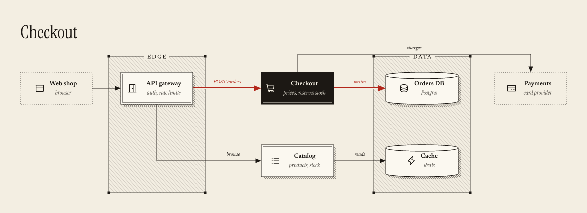
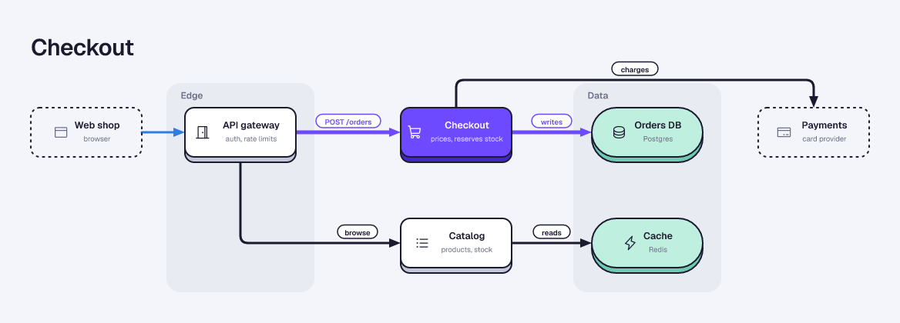

# FastDraw looks

Six looks for [FastDraw](https://github.com/coccor/fastdraw) diagrams. A look sets the colours, fonts and drawing style of a diagram; these use the same style names as the built-in look (`node`, `focal`, `store`, `external` and the rest), so any diagram can switch to one without other changes.

They used to ship inside FastDraw. They live here now, and FastDraw reads them from GitHub.

## Using a look

In the editor, open **Look**, type `coccor/fastdraw-looks` under **From GitHub**, and pick one. The editor writes the look line into the diagram.

In a `.fdraw` file, name the look by its address:

```
look "https://raw.githubusercontent.com/coccor/fastdraw-looks/main/engraved.look"
```

The `fastdraw` command line fetches the look from that address and keeps a copy in its cache folder, so the diagram renders offline after the first time (`--offline` uses only the cached copy). To keep a look next to your diagrams instead, download the `.look` file and write `look "./engraved.look"`.

## The looks

Each preview is the same checkout diagram, `previews/sample.fdraw`.

### Engraved — `engraved.look`

Double rules round every box, shadows cut in fine lines, and a black plate for the subject.



### Headline — `headline.look`

Flat blocks under a serif headline, like a newspaper graphic, with one muted crimson accent.


### Keys — `keys.look`

Boxes with a side, like keycaps.



### Listing — `listing.look`

A printout on striped listing paper, with sprocket holes down the sides.


### Offset — `offset.look`

Two inks printed slightly out of register, on grainy paper.


### Transit — `transit.look`

Thick routes with stops, like a network map.


## Making your own

`fastdraw init-look my.look` writes the built-in look to a file to start from, and `fastdraw preview-look my.look` draws every style on one sheet. The [look guide](https://github.com/coccor/fastdraw/blob/main/guide/look.md) lists every setting. Put the file in any public GitHub repository and it can be loaded the same way.

## License

MIT, see [LICENSE](LICENSE).
