# FastDraw looks

Looks for [FastDraw](https://github.com/coccor/fastdraw) diagrams. A look sets the colours, fonts and drawing style of a diagram; these use the same style names as the built-in look (`node`, `focal`, `store`, `external` and the rest), so any diagram can switch to one without other changes.

- Cloud looks: **Azure**, **AWS**, **Google Cloud** and **Kubernetes**, each with its own icons and its groups (VPCs, subnets, resource groups, namespaces).
- Looks for a use: **Print** (black and white), **Blueprint**, **High contrast** (low vision and colour blindness) and **Terminal**.
- Company styles: **Carbon** (IBM's technical diagrams), **Vercel** (Vercel's docs) and **FigJam** (a FigJam board), and **Tiles** (soft white tiles, after a threat-modelling app). Carbon and Tiles need a FastDraw with `side=`, `icon.block=`, `icon.bg=`, `shadow=` and `icon.dx=`.
- Six styles of drawing: **Engraved**, **Headline**, **Keys**, **Listing**, **Offset** and **Transit**. These used to ship inside FastDraw.

## Using a look

In the editor, open **Look**, type `coccor/fastdraw-looks` under **From GitHub**, and pick one. The editor writes the look line into the diagram.

In a `.fdraw` file, name the look by its address:

```
look "https://raw.githubusercontent.com/coccor/fastdraw-looks/main/engraved.look"
```

The `fastdraw` command line fetches the look from that address and keeps a copy in its cache folder, so the diagram renders offline after the first time (`--offline` uses only the cached copy). To keep a look next to your diagrams instead, download the `.look` file and write `look "./engraved.look"`.

## Cloud looks

Each is drawn the way that cloud's own documentation draws architecture, with its own icons in place of FastDraw's outlines and extra styles for its groups. The style names stay the built-in look's, so a diagram drawn for it switches with one line; an icon it already uses from FastDraw's set still draws. Azure keeps the built-in box sizes; AWS boxes are 144x104 and Kubernetes boxes 144x112, to hold the icon above the name.

The icons and the font are fetched by address from jsDelivr, at fixed versions: the editor fetches the ones a diagram uses, and the command line keeps a copy for `--offline`. `fastdraw icons <look>` lists a look's icons, and `fastdraw icons <look> queue` searches them.

### Azure — `azure.look`

Azure blue, Open Sans and 146 Azure service icons by short name (`icon=app-service`, `functions`, `sql-database`, `cosmos-db`, `key-vault`, `front-door`, `service-bus`), from [Ben Coleman's icon collection](https://github.com/benc-uk/icon-collection). Groups: `subscription`, `resource-group`, `vnet`, `subnet`.

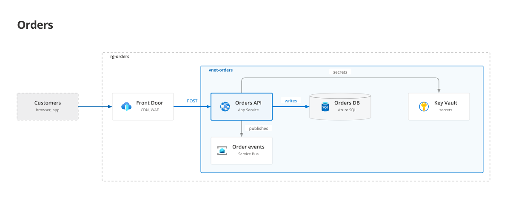

### AWS — `aws.look`

As the AWS Solutions documentation draws it: no boxes, each service is its 48px icon with the name under it and an italic second line; people and devices are AWS's generic icons (`icon=users`, `user`, `client`, `mobile-client`, `internet`). Groups are frames with the group's own icon as a tab in the top-left corner: `aws-cloud` (the AWS logo), `cloud-group`, `account`, `region`, `vpc`, `public-subnet`, `private-subnet`, `auto-scaling`, `data-center`; also `az` and `security-group`, and `zone`, a dashed generic group that shows any icon it is given as its tab. Lines are dark with open heads, and `callout "1"` numbers the flow in black circles. Arimo (Arial's widths) and all 300 AWS architecture service icons (the [`aws-icons`](https://www.npmjs.com/package/aws-icons) package), with the short names people use for common services (`icon=lambda`, `s3`, `dynamodb`, `rds`, `ec2`, `ecs`, `eks`, `api-gateway`, `cloudfront`, `sqs`, `sns`, `elb`) and the rest named after the service. A service's box is 144x104. The group tabs need FastDraw's `icon.pos=corner`.


### Google Cloud — `gcp.look`

As Google Cloud's architecture docs draw it (the Enterprise Application Blueprint): white cards with heavy dark outlines and the product icon on the left, data as a card with a grey card behind it, and nested panels with the name centred at the top: `project` light blue, `region` grey, `gke-cluster` blue, `namespace` yellow, `service-group` white. Lines are dark with open heads, dashed (`style=return`) for the control plane. Also `google-cloud` (a blue panel), `vpc`, `on-premises`, `subsystem-blue` and `subsystem-green`. Google Sans and Google Cloud's 45 product and category icons (`icon=cloudrun`, `gke`, `cloudsql`, `bigquery`, `cloud-storage`, `vertexai`; the [`gcp-icons`](https://www.npmjs.com/package/gcp-icons) package).

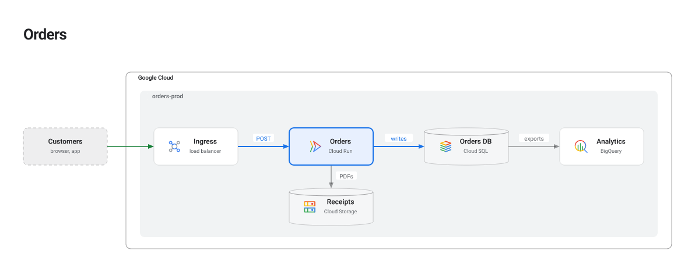

### Kubernetes — `kubernetes.look`

As kubernetes.io draws it, after its Components of Kubernetes and Labels and Selectors diagrams: each resource is the project's blue heptagon with its short name inside and its name under it; a `cluster` is a light blue panel holding a pale `control-plane` panel and darker `k8s-node` panels; a Deployment is a `zone`, a black rounded frame with its icon (`icon=deploy`) on the corner, and its ReplicaSet a `pod-group` inside it; labels and selectors are green and red plates (`k8s-label "app: A"`, `selector "app=A"`). For request flows, as in the Ingress and Gateway diagrams: `step` boxes are solid blue, an `external` client is a grey pill, `style=link` is the dotted request, and line labels sit on grey plates. Open Sans. Icons by kubectl's short names or the full ones (`icon=pod`, `svc` or `service`, `deploy` or `deployment`, `rs`, `sts`, `ing`, `cm`, `pvc`, `hpa`), and the control plane's parts (`api`, `sched`, `c-m`, `c-c-m`, `kubelet`, `k-proxy`, `etcd`, `node`). They are the project's labeled icons ([kubernetes/community](https://github.com/kubernetes/community/tree/master/icons), Apache 2.0), kept in `icons/kubernetes` with the names turned into outlines so they draw in PNG exports too. A resource's box is 144x112. The corner icons need FastDraw's `icon.pos=corner`.

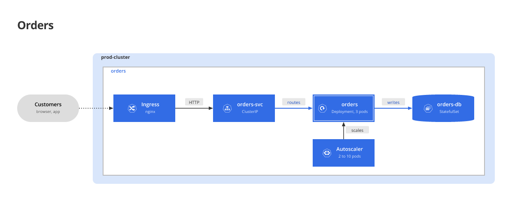

The icons are the clouds' and projects' own artwork, under the terms each publishes for using them in architecture diagrams.

## Looks for a use

Each restyles every style of the built-in look, not only its colours, and keeps the style names, so a diagram switches with one line. The previews are the checkout diagram, `previews/sample.fdraw`.

### Print — `print.look`

Black and greys on white, for a printer or a PDF read in greyscale. Nothing depends on colour: the subject has a heavy double rule, data stores a halftone, the main path is the heavier line, a request has an open arrowhead and a response a dashed line. Libre Franklin with a Newsreader title.

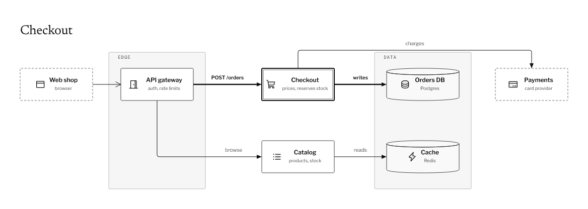

### Blueprint — `blueprint.look`

White lines on bright blue squared paper, like an architect's plan. Boxes are outlines with the grid showing through, groups are walls of two parallel lines, the subject has a hatched wall down two sides, and lines are thin with small solid heads. Everything is the one white. The squared paper needs FastDraw's `canvas grid=`.

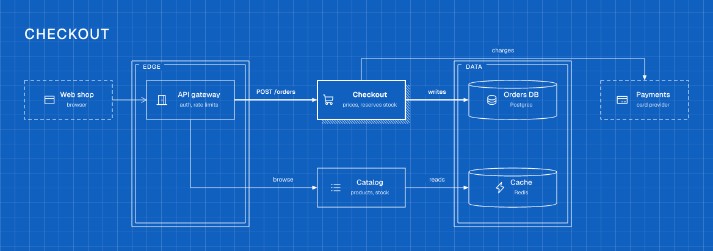

### High contrast — `high-contrast.look`

For readers with low vision or colour blindness. Black on white, lines 2px and heavier, text at a contrast of 7:1 or more, and every style told apart by more than colour: the subject by the heaviest outline, a hosted platform by a double one, a request by long dashes, a response by short ones. Set in [Atkinson Hyperlegible](https://www.brailleinstitute.org/freefont/), drawn to keep similar letters apart.

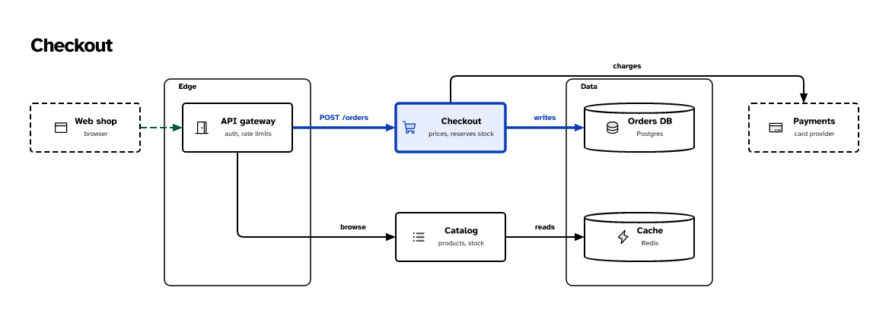

### Terminal — `terminal.look`

One monospace face (JetBrains Mono) on near-black, square boxes in thin grey, a double border for the subject like a box drawn with line characters, faint scan lines, and phosphor green for the subject and the main path. Monospace is wide, so keep text in boxes short.

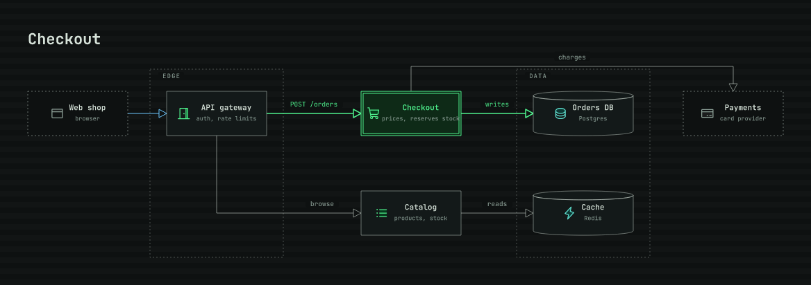

## Company styles

Each draws the way a company draws its own diagrams: its own kinds of element as extra styles, and the built-in look's style names kept, so a diagram drawn for the built-in look still draws. Each preview is a diagram composed the way that company composes one, in `previews/`.

### Carbon — `carbon.look`

After IBM's [technical diagram guidelines](https://www.ibm.com/design/language/infographics/technical-diagrams/design). Most things are small nodes: a 48px square in the category's colour with a white icon, the name in semibold under it (`node` Blue 60 for network, `store` Teal, `cloud` Purple, `security` Red, `devops` Magenta, `backend` Gray). People are black circles (`external`). The subject and `compute` are large colour-block nodes, with their details left-aligned. Groups are frames with a bar down the left side: `cloud-group` and `subnet` blue, `region` grey, `network-group` white with a blue bar, `az` dotted, `security-group` dotted red. Connectors are black, 1px, with square elbows. IBM Plex Sans, text always black; finish with a legend, as IBM asks. Needs FastDraw's `icon.bg=`, `side=` and `icon.block=`.

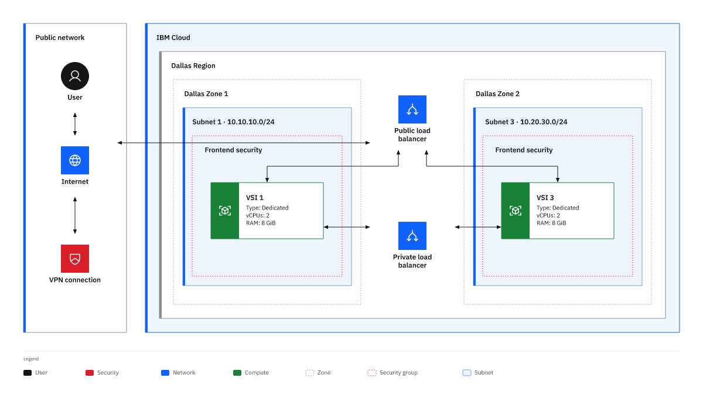

### Vercel — `vercel.look`

After the diagrams in [Vercel's docs](https://vercel.com/docs/fundamentals/infrastructure). Boxes of words only, in regular Geist at 13px, white with a light grey hairline. The outer panel (`zone`) is hatched with fine diagonal lines; `region` is a plain panel and `panel` a grey one inside it, each captioned in bold Geist Mono capitals. `external` is a browser window, `optional` a dashed box (one case of several), `chip` a small square holding an icon, `badge` a black circle sitting on a line. Connectors are black hairlines with rounded elbows, labelled in mono on pill plates; `primary`, `link` and `miss` are blue, teal and red with pills to match.

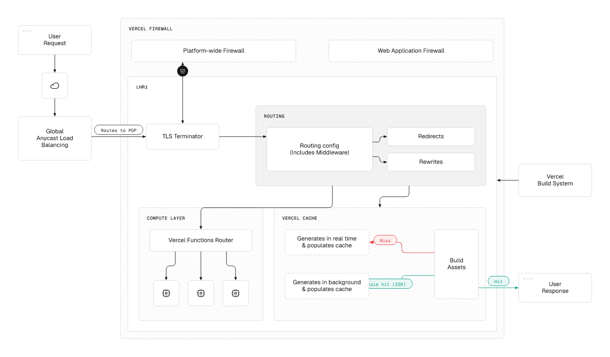

### FigJam — `figjam.look`

Like a [FigJam](https://www.figma.com/figjam/) board. Grey dots on white; flat shapes in FigJam's colours with square corners and no outline: yellow steps, violet circles where a flow starts (`external`, `terminal`), terracotta diamonds for questions, the subject in full green. Sticky notes are squares that sit a little off the page. A `zone` is a section, a pale panel named on a yellow tag above its corner (`section` is a violet one), so leave room above it. Connectors are black, 1.5px. `cursor` and `name-tag` draw the people on the board. Inter.

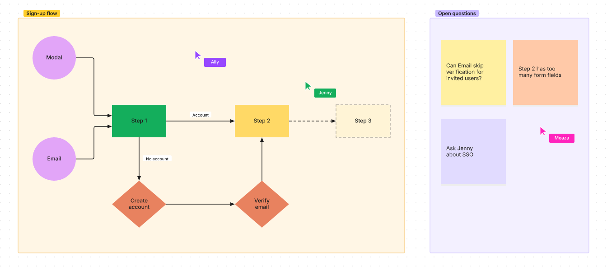

### Tiles — `tiles.look`

After a threat-modelling app's diagram canvas. White square tiles with no outline floating on a soft shadow, a thin dark icon with a small name under it, on a pale lavender page; the subject in indigo. Groups have rounded corners and are named above their top edge beside a round lavender badge on their corner: `zone` in long grey dashes, `group` lavender with a thin indigo outline, `frame` a plain grey outline. `status-red`, `status-orange` and `status-yellow` are dots for a tile's corner. Lines are thick dark grey with square elbows, labelled in small capitals on dark pills; `primary` is teal, `alert` red. Roboto. Needs FastDraw's `shadow=`, `icon.bg=` and `icon.dx=`.

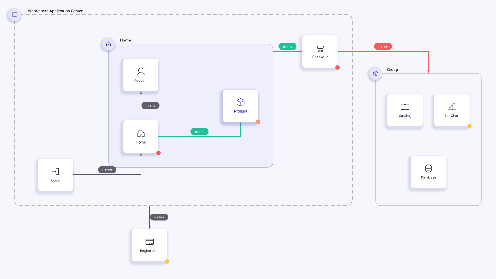

## Styles of drawing

Each preview is the same checkout diagram, `previews/sample.fdraw`.

### Engraved — `engraved.look`

Double rules round every box, shadows cut in fine lines, and a black plate for the subject.


### Headline — `headline.look`

Flat blocks under a serif headline, like a newspaper graphic, with one muted crimson accent.

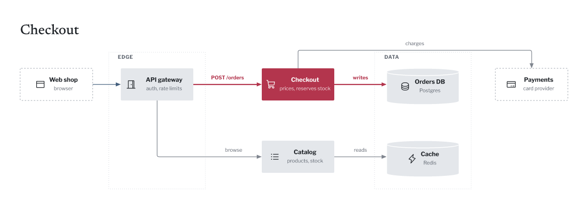

### Keys — `keys.look`

Boxes with a side, like keycaps.


### Listing — `listing.look`

A printout on striped listing paper, with sprocket holes down the sides.


### Offset — `offset.look`

Two inks printed slightly out of register, on grainy paper.

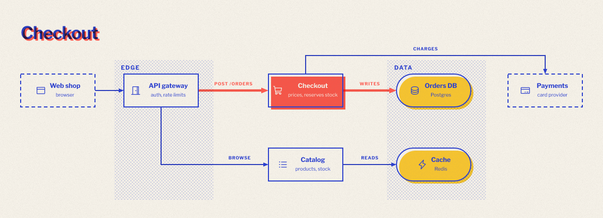

### Transit — `transit.look`

Thick routes with stops, like a network map.


## Changing these looks

Engraved, Keys, Listing, Offset and Transit are written by `tools/gen-looks.py`, which keeps their style names in step with each other; edit it and run `python3 tools/gen-looks.py`. Headline is edited by hand.

The cloud looks are written by `tools/gen-cloud-looks.py`, the looks for a use by `tools/gen-purpose-looks.py` and the company styles and Tiles by `tools/gen-house-looks.py`, all from `tools/base-styles.txt` (the built-in look's styles) with the helpers in `tools/lookgen.py`; `tools/aws-icons.txt` lists the files in `aws-icons@3.3.0`. Run `python3 tools/gen-cloud-looks.py`, `python3 tools/gen-purpose-looks.py` and `python3 tools/gen-house-looks.py`. The diagrams in `previews/` draw the preview images: `fastdraw render previews/aws.fdraw --no-embed --scale 1`.

## Making your own

`fastdraw init-look my.look` writes the built-in look to a file to start from, and `fastdraw preview-look my.look` draws every style on one sheet. The [look guide](https://github.com/coccor/fastdraw/blob/main/guide/look.md) lists every setting. Put the file in any public GitHub repository and it can be loaded the same way.

## License

MIT, see [LICENSE](LICENSE).
